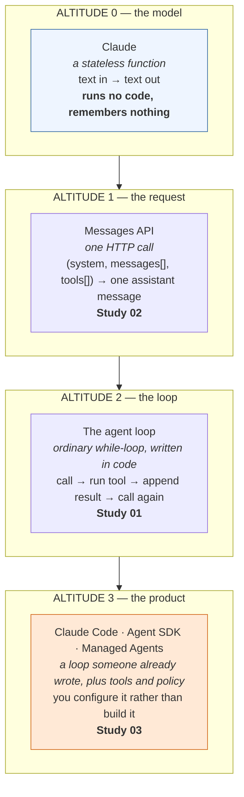
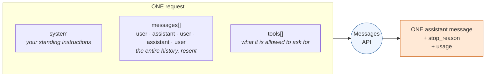
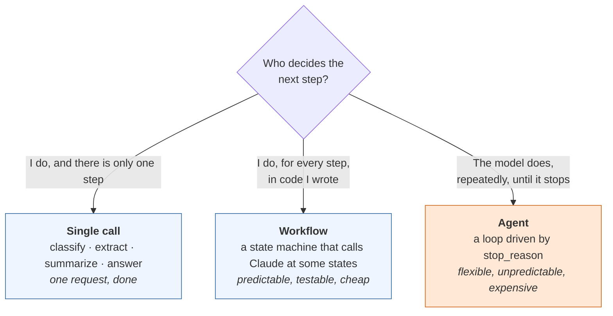
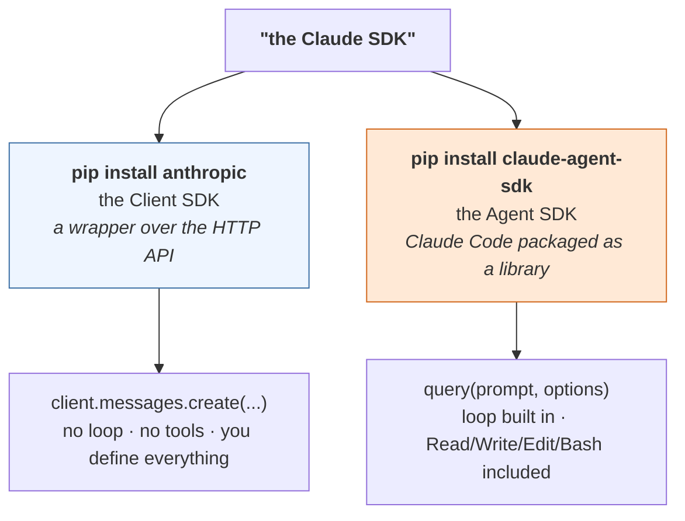
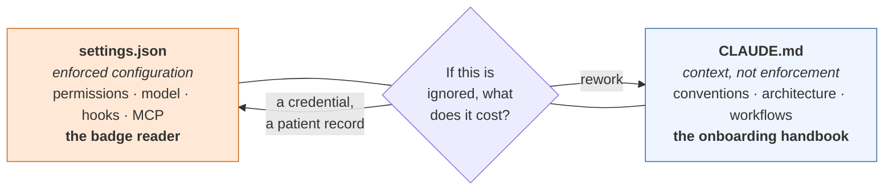
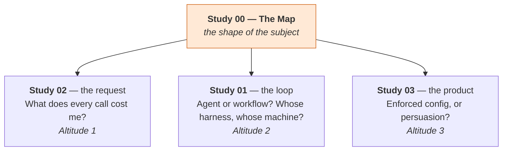

# Claude Study 00a — The Map

**Covers:** **one analogy for the whole stack** — a brilliant contractor with no memory — mapped term by term to the code → then the whole Claude stack at **10,000 feet**, before any detail — the **four altitudes** (model → request → loop → product) and which study lives at each → **what a message actually is**, and why "the Messages API" is a worse name than it sounds → the one question that decides whether you are **building an agent or making a call** → **"the Claude SDK" is two different packages**, and which one you want → the **four ways** to build an agent, as a single table → where **Claude Code** sits (a product, not an SDK) → and a **settled vocabulary** for the eight words the material uses loosely.

**Read this before Studies 01–03.** It contains no new material. Everything here is stated in more depth later; this page exists so you know what you are looking at when you get there.

**Series context:** the **ground floor of the Claude track**. The source course (Claude Certified Developer — Foundations, Andrew Brown / ExamPro, freeCodeCamp) is built bottom-up: concepts arrive in the order the API documents them, and the organizing frame arrives after the parts it organizes. That order works if you already know the shape. If you don't, you spend the first hour unable to tell whether a thing you just learned is a product, a package, a protocol, or a field in a JSON body. This page is the shape.

---

## Start here: one analogy for the whole stack

Before any term, one picture. Everything in this track is a variation on it, and when a concept stops making sense, come back here.

> **You have hired a brilliant, very fast contractor. You pay them by the word. And every single time they walk into your office, they have no memory of ever having met you.**

That is the model. Not a metaphor for marketing — a working mental model that predicts the system's real behaviour, including the parts that seem perverse.

Because they remember nothing, **every visit you hand them the entire file folder again**: the engagement letter on top, then the whole back-and-forth so far. They read it, write exactly one reply, hand the folder back, and forget everything. If you want them to continue, you walk back in with the folder — now one page thicker.

They are also, strictly, **a desk worker**. They cannot open a filing cabinet, phone a vendor, or touch a system. What they *can* do is fill out a request form: *"please pull invoice 4471 and tell me what it says."* You take the form, do the thing yourself, write the answer on a new page, and put it in the folder. That exchange — form out, answer in — is the whole of what people call "tool use," and the walking back and forth is the whole of what people call "the agent loop."

### The analogy, the term, and where the code lives

This is the table to keep next to you. Left column is what is actually happening. Middle is what the material calls it. Right is where it shows up in code.

| In the office | The term | In code |
|---|---|---|
| The contractor | the **model** | `model="claude-opus-5-5"` |
| One page in the folder | a **message** | `{"role": "user", "content": ...}` |
| The whole folder, handed over again | the **conversation history** | the `messages[]` array |
| The engagement letter clipped on top | the **system prompt** | `system="..."` |
| A photo, a contract, a PDF in the folder | **content blocks** | `{"type": "image" / "document"}` |
| The blank request forms they're allowed to use | **tools** | `tools=[...]` |
| A filled-out request form | a **`tool_use` block** | `stop_reason == "tool_use"` |
| Your answer, written on a new page | a **`tool_result` block** | appended to `messages[]` |
| You walking to the cabinet and back | the **agent loop** | `while stop_reason == "tool_use":` |
| "Here's my answer, I'm done" | **`end_turn`** | `stop_reason == "end_turn"` |
| How many pages fit on their desk at once | the **context window** | tokens, counted per call |
| Leaving the same first 50 pages permanently on the desk | **prompt caching** | `cache_control` |
| The hours and spend you authorized | **termination budgets** | `max_turns`, `max_budget_usd` |
| Which cabinets their badge opens | **permissions** | `allow` / `ask` / `deny` |
| The staff handbook you hope they read | **`CLAUDE.md`** | a markdown file in the repo |
| The badge reader on the door | **`settings.json`** | enforced configuration |
| Spot-checking a sample of their work against a rubric | an **eval** | a test suite with a score |

### Why the analogy earns its place

A good analogy is not a teaching decoration; it is a predictive model. This one predicts the behaviours that surprise people most:

| The thing that surprises people | What the analogy already told you |
|---|---|
| "Why does a long session cost so much?" | You re-hand them the whole folder every visit. Visit 40 means re-reading 40 visits' worth of pages. |
| "Why did it stop halfway?" | You authorized four hours. They used four hours. |
| "Why won't it stop?" | **You never said how many hours.** |
| "Why does it give a different answer each time?" | They are a person, not a lookup table. Ask twice, get two wordings. |
| "Why did it do something I told it not to?" | You wrote it in the handbook. Handbooks are not badge readers. |
| "Why did it leak a file after reading that document?" | **Someone slipped a forged instruction into the folder, and they cannot tell your pages from a planted one.** |
| "Why can't I just unit-test it?" | You don't unit-test a contractor. You sample their work against a rubric. |

That last-but-one row is the one to sit with, because it is the security model of the entire field in one sentence. The contractor works *only* from what is in the folder, and has no way to know which pages you wrote. Anything that gets into the folder — a web page, a support ticket, a PDF a customer uploaded — speaks with your voice.

> **Where the analogy breaks, and it matters.** A human contractor would phone you about a strange instruction, notice that the numbers look wrong, and refuse an obviously illegal request. **Do not import that part.** This contractor has no judgment about the engagement, no suspicion, and no instinct for self-preservation. They are brilliant inside the folder and blind outside it. Every safeguard a real contractor's judgment would have provided, you now build.

---

## Part 0 — The four altitudes

Everything in this track sits at one of four altitudes. Confusion in this subject is almost always an altitude error: two people using the same word about different layers.



Read it downward and each layer is built from the one above it. Three consequences are worth having in hand before anything else:

| Altitude | The thing that surprises people |
|---|---|
| 0 — model | The model **cannot run a tool and cannot call itself.** It can only say *"run this tool"* and stop. |
| 1 — request | There is **no conversation on Anthropic's side.** You resend the entire history every call. |
| 2 — loop | The agent loop is **your code, not a model behaviour.** If nothing loops, you do not have an agent. |
| 3 — product | At this altitude you stop writing the loop and start **constraining** one. The skills are different. |

> **In plain terms.** Altitudes 0–1 are a vending machine: coins in, one item out, no memory of you. Altitude 2 is you standing there feeding it coins in a pattern. Altitude 3 is someone selling you the whole arrangement with the coin-feeding already automated, and your job becomes deciding what it is allowed to buy.

---

## Part 1 — What a message actually is

**A message is one turn in a transcript.** It is a two-field object: a `role` (`"user"` or `"assistant"`) and `content`.

```python
{"role": "user", "content": "Summarize this visit note."}
```

`content` is either a plain string or — the form that matters — a **list of blocks**. A block has a `type`. The common ones:

| Block type | Appears in | Carries |
|---|---|---|
| `text` | both roles | words |
| `image` | user | base64 bytes, a URL, or a `file_id` |
| `document` | user | a PDF |
| `tool_use` | assistant | *"run this tool, with these inputs"* |
| `tool_result` | user | what your code got back when it ran it |
| `thinking` | assistant | reasoning, when extended thinking is on |

Two things follow, and both are routinely misread.

**A message is not a request.** One HTTP request carries the *whole* `messages` array and returns *one* new assistant message. Ten messages is still one call.



**"The Messages API" is a worse name than it sounds.** It suggests a messaging product — something that holds your conversation, like a chat service. It does not. It is a single stateless function:

> `(system, messages, tools) → one assistant message`

Everything else in this track — chat, workflows, agents, Claude Code itself — is that one function, called repeatedly, with the result appended to the array each time. There is no second mechanism. When you later read that a 400-turn coding session costs what it costs, this is why: turn 400 resends turns 1–399.

> **In plain terms.** The transcript is a whiteboard you photograph and send in full every time you want a reply. Anthropic reads the photograph, writes one line, and forgets. You keep the whiteboard.

**Study 02** is this altitude in full: blocks, the system prompt as a privilege level, `max_tokens`, every `stop_reason`, streaming, caching, and batch.

---

## Part 2 — Am I building an agent, or making a call?

This is the question the course leaves vague for an hour, and it has a one-line test.

**Who decides what happens next — you, or the model?**



**The marker is the loop, and the loop is visible in your own source code.** An agent is code shaped like this:

```python
while response.stop_reason == "tool_use":
    result = run_the_tool(response)          # your code does this
    messages.append(result)                  # the transcript grows
    response = client.messages.create(...)   # ask again
```

No `while`, no agent. A single call with `tools=[...]` defined is **not** an agent — it is one call that may come back asking for a tool. Whether anything happens next is entirely up to code you wrote.

This matters because the three answers have different costs, different failure modes, and different things that can go wrong in production. Most things people build as agents are workflows that would be cheaper, more testable and more reliable as workflows. **Start at the top of that diagram and move down only when forced.**

**Study 01** is this altitude: agent architecture as a *dynamic policy* rather than a state machine, workflow architecture as the state machine it is, when subagents actually pay, and the four ways to get a loop.

---

## Part 3 — "The Claude SDK" is two different packages

People say *"the Claude SDK"* and mean either of two unrelated products. This is the single most common early confusion, and it is a naming problem, not a conceptual one.



| | **Client SDK** (`anthropic`) | **Agent SDK** (`claude-agent-sdk`) |
|---|---|---|
| What it is | a wrapper over the Claude HTTP API | Claude Code packaged as a library |
| You call | `client.messages.create(...)` | `query(prompt, options)` |
| The agent loop | none by default — you write it, or use the Tool Runner helper | built in |
| Built-in tools | **none.** You define every tool | Read, Write, Edit, Bash, Glob, Grep, WebSearch, WebFetch … |
| Also covers | Batches, Files, token counting, Models, Managed Agents | hooks, subagents, MCP, permissions, sessions |
| Reach for it when | anything that is not a coding/filesystem agent: chat, extraction, classification, RAG, your own tools | you want Claude Code's abilities inside your own program |

**So: not all Claude SDK is Agent SDK.** Most Claude applications use only the Client SDK. The Agent SDK is a narrower, heavier thing — it spawns the `claude` CLI as a subprocess, which is why a Python-only install is not enough and you also need the Node package.

If you remember one line: **the Client SDK gives you a model. The Agent SDK gives you a coding agent.**

---

## Part 4 — The four ways to build an agent, on one page

Two independent questions separate every option. Not one question — this is why the options feel like a flat list of five similar things when they are actually a 2×2.

1. **Who supplies the harness** — the loop and the context management?
2. **Who supplies the deployment** — the machine the tools actually run on?

| # | Approach | You write | Harness | Deployment | Tools you get |
|---|---|---|---|---|---|
| 1 | **Manual loop** (Messages API) | the `while` loop | **yours** | **yours** | only what you define |
| 2 | **Tool Runner** (`beta.messages.tool_runner`) | just the tool functions | SDK's | **yours** | only what you define |
| 3 | **Managed Agents** | agent config | Anthropic's | **Anthropic's** | hosted sandbox: bash, files, code exec, Skills, MCP |
| 4 | **Agent SDK** (`claude-agent-sdk`) | a prompt + options | Claude Code's | **yours** | Read/Write/Edit/Bash/Glob/Grep/WebSearch + MCP + subagents |

Two traps live in that table.

**Options 2 and 4 both "give you the loop,"** so they get conflated constantly. The difference is *whose* loop and *whose* tools. The Tool Runner runs **your** tools. The Agent SDK ships **Claude Code's** tools and is a filesystem/coding agent out of the box. Different packages, different problems.

**Only option 3 takes the machine off your hands.** That is the real line through the table. Everything else, you deploy, monitor and pay for.

> **The one-line frame:** harness and deployment are **two separate purchases.** The manual loop buys neither. Tool Runner and the Agent SDK buy the harness only. Managed Agents buys both.

**Study 01 Part 4** is this with the decision tree, the hand-written loop in full, and Managed Agents' object model (agent · environment · session · deployment · credential vault).

---

## Part 5 — Where Claude Code fits

Claude Code is not on the SDK list above, and that is the point: **it is a product built at Altitude 3, not a library you build with.** The Agent SDK is Claude Code offered as a library; the CLI is Claude Code offered as a tool.

The practical difference is what the skill looks like:

| | At Altitudes 1–2 you… | At Altitude 3 you… |
|---|---|---|
| Work by | writing code | writing configuration |
| Control tools by | choosing which functions to expose | `allow` / `ask` / `deny` rules |
| Control context by | building the `messages` array | `CLAUDE.md`, imports, session hygiene |
| Control cost by | `max_tokens`, caching, batch | model pinning, scope, what you let it read |
| Fail by | a bug | **a rule you thought was enforced and wasn't** |

That last row is the whole of Study 03. Claude Code has **two** configuration systems that look alike and behave nothing alike:



> **In plain terms.** Nobody writes *"please do not enter the server room"* in an employee handbook and calls the room secured. `CLAUDE.md` is the handbook. `settings.json` is the badge reader. Both are legitimate; putting a thing in the wrong one is how *"Claude ignored my rule"* happens.

**Study 03** is this altitude: the four scopes, the precedence ladder (which does not run the way the course's diagram reads), imports and the depth at which they silently stop, 160 settings keys extracted from the shipped build, permission rules, MCP, plugins, model pinning, and an applied section that configures real repositories.

---

## Part 6 — You are here



| Study | The question it answers | Altitude |
|---|---|---|
| **00** — The Map | What am I even looking at? | all |
| **01** — Agent architecture & the Agent SDK | Should this be an agent at all, and if so, whose loop? | 2 |
| **02** — The Messages API & the cost levers | What is actually in a request, and what does each field cost? | 1 |
| **03** — Configuring Claude Code | Which of my rules are enforced, and which are merely requests? | 3 |

Studies 01 and 02 are numbered in the order the course teaches them. **If you are orienting rather than revising, read 02 before 01** — the request is underneath the loop, and the loop makes more sense once you have seen what it is a loop *of*.

---

## Part 7 — The vocabulary, settled

Eight words the material uses loosely. These definitions hold for the rest of the track.

| Word | What it means here | What it is **not** |
|---|---|---|
| **Message** | one turn in a transcript: a role plus content blocks | not a request — one request carries the whole array |
| **Turn** | one user message plus the assistant message answering it | not one API call; an agentic turn can span many |
| **Call** | one HTTP request to the Messages API | not one message |
| **Block** | a typed element of `content`: text, image, `tool_use`, `tool_result`, `thinking` | not a message |
| **Tool** | a function *you* describe to the model, which the model can only *ask* you to run | never something the model executes itself |
| **Loop** | your `while` on `stop_reason` — the thing that makes an agent an agent | not a model behaviour, not inside the model |
| **Harness** | the surrounding program that turns a model into an agent: loop, context management, tool dispatch | not the model, and not the deployment |
| **Deployment** | the machine the tools actually execute on | a separate purchase from the harness |

One more, because the course uses it three ways: **"agent."** It means (a) the architectural pattern — a dynamic policy, Study 01 Part 1; (b) a concrete product object — a Managed Agents `agent` config, Study 01 Part 7; (c) colloquially, any LLM program at all. When it matters, this track says which.

---

*Built for the Emergtech AI Engineer Accelerator. Concepts mined from the Claude Certified Developer — Foundations course (Andrew Brown / ExamPro, freeCodeCamp) and cross-checked against the installed SDKs, Anthropic's reference documentation, and the shipped Claude Code build.*
